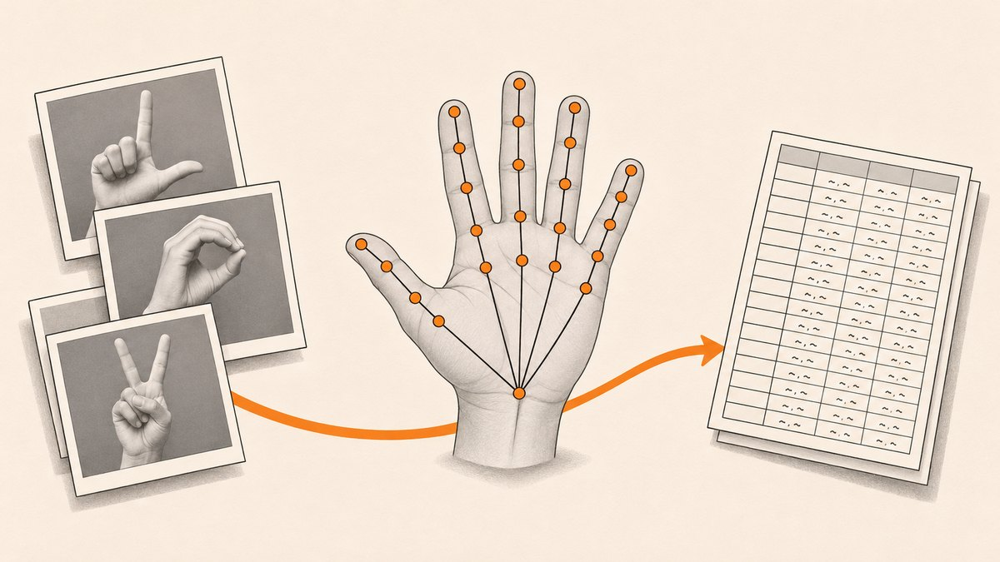

<p align="center"></p>

# Hand Sign Dataset Builder

An early experiment that extracts MediaPipe hand landmarks from a folder of hand sign photos and writes their coordinates to a CSV file.

## What it does

- Loads every `.png` in a data folder (sample images `A_0`, `A_1`, `B_0` are included).
- Runs MediaPipe Hands on each image and draws the detected landmarks.
- Dumps the raw landmark output to `demo.txt`.
- Parses `demo.txt` and writes the x and y values of the 21 landmarks to `demodata.csv` (columns `x0, y0 ... x20, y20`), one row per hand.

## How it works

`HandtrackingMin.py` globs the image folder, converts each image to RGB and calls `mp.solutions.hands.Hands().process()`. All landmarks are collected in a list, written as text to `demo.txt`, and the image is shown until a key is pressed. It then calls `something()` in `exclepy.py`, which reads `demo.txt` line by line, drops every third line (the z values), and writes the first two hands (42 values each) to `demodata.csv` with the `csv` module.

`Exp/demodata23.csv` shows the target format from a later attempt: clean numeric `x, y, z` columns for each landmark.

## Tech

- Python 3
- OpenCV (`cv2`)
- MediaPipe (Hands)
- `glob`, `csv` (standard library)
- gTTS and playsound (in `TextToSpeech.py`, not used by the pipeline)

## Run it

```bash
pip install opencv-python mediapipe
cd HandTracking
python HandtrackingMin.py
```

Before running, change the image folder in `HandtrackingMin.py` (and `TEST.py`) from the hard-coded `E:\Python\HandTracking\Data\*.png` to your own path, for example `Data/*.png`. Press any key to step to the next image. No webcam is needed for this script.

## Project structure

- `HandTracking/HandtrackingMin.py`: image folder to landmarks pipeline (entry point).
- `HandTracking/exclepy.py`: converts `demo.txt` into `demodata.csv`.
- `HandTracking/HandTrackingModule.py`: reusable MediaPipe hand detector class (webcam demo when run directly).
- `HandTracking/TEST.py`: shows each image in the data folder.
- `HandTracking/TextToSpeech.py`: gTTS helper.
- `HandTracking/main.py`: default PyCharm template, unused.
- `HandTracking/Data/`, `A_0.png`, `A_1.png`, `B_0.png`: sample sign photos.
- `HandTracking/Hand.jpeg`: reference photo of an open hand.
- `HandTracking/demo.txt`, `demodata.csv`, `Data.xlsx`: sample outputs.
- `HandTracking/Exp/`: experiments copied from the sign language project (`GUI.py`, `server.py`, `HandTrackingMin.py`) and `demodata23.csv`.
- `HandTracking/__pycache__/`: compiled cache, committed by accident.

## Notes

- This is a work in progress, not a finished tool. The image path is hard-coded to a Windows `E:` drive.
- The CSV written by `exclepy.py` stores tokenised text such as `['x:', '0.58']` in each cell rather than plain numbers, and only the first two hands are written.
- The landmark list is never reset between images, so later rows include landmarks from earlier images.
- The scripts in `Exp/` do not run on their own: `GUI.py` references functions and modules that are not in this repository, and `HandTrackingMin.py` uses invalid calls (`mp.zeros`, `cv2.COLOR_BGR2`).
- No labels are attached to the CSV rows; the class is only in the image file name.
